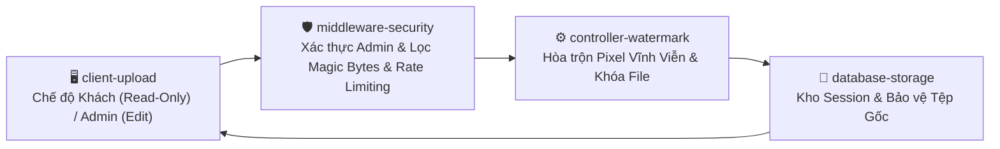

# HỆ THỐNG ĐÓNG WATERMARK & BẢO VỆ BẢN QUYỀN
### Nâng Cấp: Xác Thực Quản Trị Viên & Phân Quyền Truy Cập Chỉ Đọc
**Bản Quyền Độc Quyền: Ms. Trần Thị Thu Trang**

---

## 🔒 Tổng Quan Các Nâng Cấp Bảo Mật Mới

Hệ thống được nâng cấp toàn diện theo đặc tả bảo mật doanh nghiệp:

### 1. Phân Quyền Quản Trị Viên (Password-Protected Editing)
* **Quy trình thiết lập an toàn (First-Run Setup)**: Cho phép chủ dự án (Ms. Trang) khởi tạo mật khẩu quản trị viên ban đầu.
* **Mã hóa Scrypt cấp cao**: Mật khẩu được băm bằng thuật toán **Scrypt** (`scrypt:32768:8:1`) với muối ngẫu nhiên (salt), hoàn toàn không lưu trữ plain-text trong code, HTML hay JavaScript.
* **Quyền hạn độc quyền của Quản trị viên**:
  * Thêm, chỉnh sửa, di chuyển, đổi kích cỡ hoặc xóa watermark.
  * Thay đổi chữ watermark, độ mờ, màu sắc hoặc vị trí.
  * Tải lên hoặc thay thế tệp gốc.
  * Cấu hình các thiết lập bảo mật và đổi mật khẩu quản trị.

### 2. Chế Độ Khách Chỉ Đọc (Read-Only Access for Public Users)
* **Người dùng công cộng (Chưa đăng nhập)**:
  * Được phép xem bản xem trước chất lượng cao của tệp đã đóng watermark.
  * Được phép tải về tệp thành phẩm có chứa watermark vĩnh viễn (`/api/download/<session_id>`).
  * Được phép sử dụng công cụ kiểm tra tính toàn vẹn SHA-256 (`/api/verify-integrity`).
* **Nghiêm cấm người dùng công cộng**:
  * Không thể truy cập trình biên tập watermark hoặc thay đổi thiết lập (bị khóa trên giao diện và bảo vệ bằng backend decorator `@admin_required`).
  * Không thể gỡ bỏ watermark qua ứng dụng.
  * **Không thể tải về tệp gốc chưa đóng watermark** (API `/api/download-original` trả về `401 Unauthorized` nếu chưa đăng nhập admin).

### 3. Hòa Trộn Watermark Vĩnh Viễn (Permanently Composited)
* **Hình ảnh (.png, .jpg, .webp)**: Watermark được hòa trộn trực tiếp vào từng pixel (Permanent Pixel Compositing) và làm phẳng hoàn toàn (Flattened Raster), không lưu dưới dạng layer tách biệt có thể bóc tách.
* **Tài liệu PDF (.pdf)**: Watermark và đường chỉ phân cách được vẽ trực tiếp vào dòng lệnh nội dung trang (Page Content Stream), kết hợp mã hóa phân quyền **AES-256 Bit**.
* Không tuyên bố sai lệch về việc "không thể chỉnh sửa bằng mọi phần mềm ngoại vi", mà công bố chính xác cơ chế bảo vệ: Hòa trộn vĩnh viễn vào pixel và mã hóa phân quyền.

### 4. An Toàn Thông Tin & Phòng Chống Brute-Force
* **Rate Limiting Đăng Nhập**: Giới hạn tối đa 5 lần thử sai cho mỗi IP. Nếu nhập sai 5 lần, hệ thống tạm khóa tài khoản 15 phút (HTTP 429 Too Many Requests).
* **Bảo vệ Session**: Flask Session được cấu hình `HTTPOnly=True`, `SameSite='Lax'`, thời gian sống 2 giờ.
* **Bảo Mật Git**: Tệp `.gitignore` bảo vệ `data/admin_auth.json`, `data/.secret_key`, các tệp tạm thời và session, không bao giờ lộ thông tin nhạy cảm.
* **Chức Năng Đổi Mật Khẩu An Toàn**: Yêu cầu xác thực mật khẩu hiện tại trước khi cập nhật mật khẩu mới.

---

## 🏛️ Sơ Đồ Kiến Trúc Hệ Thống (4 Khối)



---

## 🚀 Hướng Dẫn Sử Dụng

### Khởi Chạy Nhanh:
Nhấp đúp chuột vào tệp:
```cmd
run.bat
```
Hoặc qua dòng lệnh:
```powershell
python app.py
```
Truy cập tại: **http://127.0.0.1:5000**

### Quy Trình Dành Cho Ms. Trang (Quản Trị Viên):
1. **Lần đầu tiên mở ứng dụng**: Nhấp vào nút **"🚀 Thiết Lập Ban Đầu"** trên thanh điều hướng để tạo mật khẩu quản trị viên bảo mật của bạn.
2. **Đăng nhập**: Nhấp **"🔑 Đăng Nhập Quản Trị"** và điền mật khẩu để kích hoạt bảng điều khiển chỉnh sửa watermark.
3. **Đóng dấu & Xuất bản**: Tải lên tệp Word/PDF/Ảnh, tùy chỉnh chữ, màu xám thanh lịch và nhấn **"🔒 ĐÓNG WATERMARK VĨNH VIỄN & XUẤT BẢN"**.
4. **Đổi mật khẩu**: Nhấp vào **"⚙️ Đổi Mật Khẩu"** khi muốn cập nhật mật khẩu mới.

---

## 🧪 Kết Quả Kiểm Thử Tự Động (8/8 Tests Passed)

Chạy bộ kiểm thử tự động toàn diện:
```powershell
python test_suite.py
```
**Kết quả: 8/8 bài test đạt 100% (OK)**:
1. `test_01_unauthenticated_user_cannot_access_editing_api`: Chặn khách gọi API chỉnh sửa (HTTP 401).
2. `test_02_unauthenticated_user_cannot_change_password`: Chặn khách đổi mật khẩu (HTTP 401).
3. `test_03_admin_login_success_and_session_persistence`: Đăng nhập quản trị và lưu session thành công.
4. `test_04_incorrect_password_rejected_and_rate_limited`: Mật khẩu sai bị từ chối; nhập sai 5 lần kích hoạt lockout (HTTP 429).
5. `test_05_final_image_contains_permanently_embedded_watermark`: Watermark được hòa trộn vĩnh viễn vào pixel ảnh.
6. `test_06_original_files_remain_protected`: Khách chỉ tải được tệp có watermark; tệp gốc được bảo vệ nghiêm ngặt.
7. `test_07_full_workflow_when_authenticated_admin`: Luồng chỉnh sửa, preview và kiểm tra tính toàn vẹn hoạt động hoàn hảo.
8. `test_08_change_password_functionality`: Tính năng đổi mật khẩu an toàn hoạt động chính xác.
